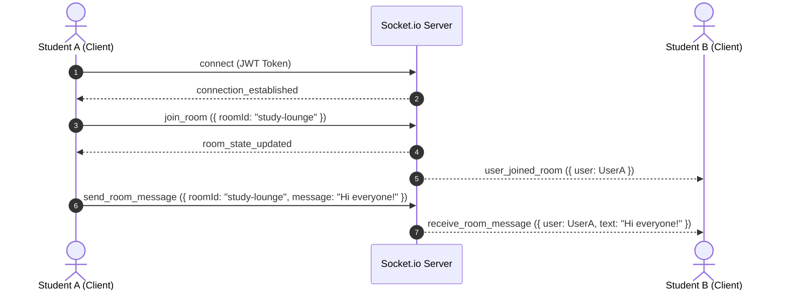

# ⚔️ ScholarQuest — Comprehensive Technical Architecture & Backend API Documentation

> **MSc IT Mini Project 2026** | Gamified Learning Platform Backend API & Real-Time Engine  
> **Author**: Jaish15  
> **Architecture**: Express REST API + Socket.io WebSockets + Judge0 Code Sandbox + Dual JSON/PostgreSQL Storage

---

## 📋 Table of Contents

1. [Executive Summary](#-executive-summary)
2. [Backend Architecture & Module Breakdown](#-backend-architecture--module-breakdown)
3. [REST API Specification](#-rest-api-specification)
4. [Real-Time WebSocket Architecture (`Socket.io`)](#-real-time-websocket-architecture-socketio)
5. [Multi-Language Code Execution Sandbox Engine](#-multi-language-code-execution-sandbox-engine)
6. [Authentication, Security & OAuth 2.0](#-authentication-security--oauth-20)
7. [Database Abstraction & Data Models](#-database-abstraction--data-models)
8. [Environment Setup & Installation](#-environment-setup--installation)

---

## 🌟 Executive Summary

The **ScholarQuest Backend** is a Node.js web server powering the ScholarQuest gamified learning ecosystem. It provides:
- **Stateless REST API** endpoints for user authentication, character state persistence, habit tracking, quizzes, and leaderboards.
- **Bi-directional WebSocket server** for StudySync study rooms, live friend activity status, and direct messaging (DMs).
- **Remote & Local Multi-Language Code Sandbox Execution** for the CodeScroll developer module (supporting Python, JavaScript, C, C++, and Ruby).
- **OAuth 2.0 Social Authentication** (Google & GitHub) alongside email/password, email verification, magic links, and password resets.

---

## 📐 Backend Architecture & Module Breakdown

```
scholarquest-backend/
├── server.js              # Entry point — Express server & Socket.io initialization
├── db.js                  # Data storage abstraction layer (JSON file DB / PostgreSQL)
├── .env.example           # Environment variable template
├── middleware/
│   └── auth.js            # JWT verification & authorization middleware
├── routes/
│   ├── auth.js            # Authentication routes (Register, Login, OAuth, Reset)
│   ├── user.js            # User state, profile updates, LeetCode profile linking
│   ├── quiz.js            # Quiz fetching, answer validation, scoring engine
│   ├── habits.js          # Habit management CRUD
│   ├── leaderboard.js     # Leaderboard ranking calculations
│   ├── friends.js         # Social graph management (Friends)
│   └── dm.js             # Direct messaging & file attachment handling
├── modules/
│   ├── studySyncSocket.js # WebSocket event handlers for rooms, presence, DMs
│   └── studySyncStore.js  # In-memory socket connection & room store
└── data/                  # Persistent JSON storage files
```

---

## 🔌 REST API Specification

### 🔐 Authentication Routes (`/api/auth`)

| Method | Endpoint | Description | Auth Required |
|---|---|---|---|
| `POST` | `/api/auth/register` | Register user account with hashed password | ❌ |
| `POST` | `/api/auth/login` | Authenticate user credentials & issue JWT token | ❌ |
| `GET` | `/api/auth/google` | Trigger Google OAuth 2.0 authentication flow | ❌ |
| `GET` | `/api/auth/github` | Trigger GitHub OAuth 2.0 authentication flow | ❌ |
| `POST` | `/api/auth/verify-email` | Verify email address using verification token | ❌ |
| `POST` | `/api/auth/magic-link` | Dispatch passwordless magic link email via Resend | ❌ |
| `POST` | `/api/auth/forgot-password` | Generate password reset token & email link | ❌ |
| `POST` | `/api/auth/reset-password` | Reset user password using token | ❌ |

### 👤 User State Routes (`/api/user`)

| Method | Endpoint | Description | Auth Required |
|---|---|---|---|
| `GET` | `/api/user/:id` | Fetch full user state (XP, Level, Coins, HP, Avatar) | ✅ |
| `PATCH` | `/api/user/:id` | Update game stats, coins, or equipped character | ✅ |
| `POST` | `/api/user/leetcode` | Link LeetCode profile username to player profile | ✅ |

### 🎯 Quiz & Habit Routes (`/api/quizzes`, `/api/habits`)

| Method | Endpoint | Description | Auth Required |
|---|---|---|---|
| `GET` | `/api/quizzes` | Fetch all available quizzes | ❌ |
| `GET` | `/api/quizzes/:id` | Fetch single quiz by ID | ❌ |
| `POST` | `/api/quizzes/submit` | Evaluate quiz submission, award XP & coins | ✅ |
| `GET` | `/api/habits/:userId` | List habits for user | ✅ |
| `POST` | `/api/habits/:userId` | Create new daily habit | ✅ |
| `PATCH` | `/api/habits/:userId/:habitId/complete` | Toggle habit completion & award streak XP | ✅ |
| `DELETE` | `/api/habits/:userId/:habitId` | Delete habit | ✅ |

### 🏆 Social & Leaderboard Routes (`/api/leaderboard`, `/api/friends`, `/api/dm`)

| Method | Endpoint | Description | Auth Required |
|---|---|---|---|
| `GET` | `/api/leaderboard` | Top 10 players ranked by Level and XP | ❌ |
| `GET` | `/api/friends/:userId` | Get user's friend list & pending requests | ✅ |
| `POST` | `/api/friends/request` | Send friend request | ✅ |
| `POST` | `/api/friends/accept` | Accept friend request | ✅ |
| `GET` | `/api/dm/history` | Get chat history between two users | ✅ |
| `POST` | `/api/dm/send` | Send direct message (with optional file upload) | ✅ |

### 💻 Code Execution Engine Endpoints (`/api/codescroll`)

| Method | Endpoint | Description | Auth Required |
|---|---|---|---|
| `POST` | `/api/codescroll/run` | Execute source code in sandbox (Judge0 / Local) | ❌ |
| `GET` | `/api/codescroll/leetcode-stats/:username` | Proxy request to LeetCode GraphQL API | ❌ |

---

## 📡 Real-Time WebSocket Architecture (`Socket.io`)

The WebSocket engine in `modules/studySyncSocket.js` manages live connections:



---

## 💻 Multi-Language Code Execution Sandbox Engine

Code execution in `/api/codescroll/run` uses a dual-tier execution pipeline:

1. **Remote Execution (Judge0 API)**:
   - Submits source code and language mapping ID (Python: `71`, JavaScript: `63`, C: `50`, C++: `54`, Ruby: `72`) to RapidAPI Judge0 endpoint.
   - Parses `stdout`, `stderr`, `compile_output`, and execution status.

2. **Native Local Process Execution (Fallback)**:
   - If Judge0 is unconfigured or unreachable, the server executes code using Node's `child_process.exec()` in isolated temporary files.
   - Enforces strict constraints:
     - **Execution Timeout**: 4,000 ms (4s limit).
     - **Buffer Size Limit**: 512 KB max output buffer.
     - **Automatic Cleanup**: Temporary files are deleted immediately post-execution via `fs.unlinkSync()`.

---

## 🔐 Authentication, Security & OAuth 2.0

- **JWT Tokens**: Signed with `jsonwebtoken` using `JWT_SECRET` and evaluated in Bearer authorization headers (`Authorization: Bearer <token>`).
- **Password Hashing**: Uses `bcryptjs` with salt rounds.
- **Social OAuth 2.0**: Integrated via `passport-google-oauth20` and `passport-github2`.
- **Transactional Mail**: Email verification, magic links, and password reset tokens dispatched via the **Resend API**.

---

## 🛢️ Database Abstraction & Data Models

Data persistence is abstracted through `db.js`:
- **JSON Storage Tier**: Reads and writes atomically to `data/*.json` files.
- **PostgreSQL Tier**: Integrated via `pg.Pool` driver for production database deployment.

### User Data Model Schema
```json
{
  "id": "uuid-v4-string",
  "username": "jayasri",
  "email": "jayasri@example.com",
  "passwordHash": "$2a$10$...",
  "xp": 450,
  "level": 4,
  "hp": 100,
  "coins": 150,
  "avatar": "wizard_purple",
  "unlockedAvatars": ["starter_hero", "wizard_purple"],
  "leetcodeUsername": "jayasri_dev",
  "createdAt": "2026-08-31T08:00:00.000Z"
}
```

---

## 🚀 Environment Setup & Installation

```bash
# 1. Install dependencies
npm install

# 2. Configure environment file
cp .env.example .env

# 3. Start development server with hot reload
npm run dev
# Server runs on http://localhost:3000
```

---

*ScholarQuest Backend API — Level Up Your Learning* ⚔️
